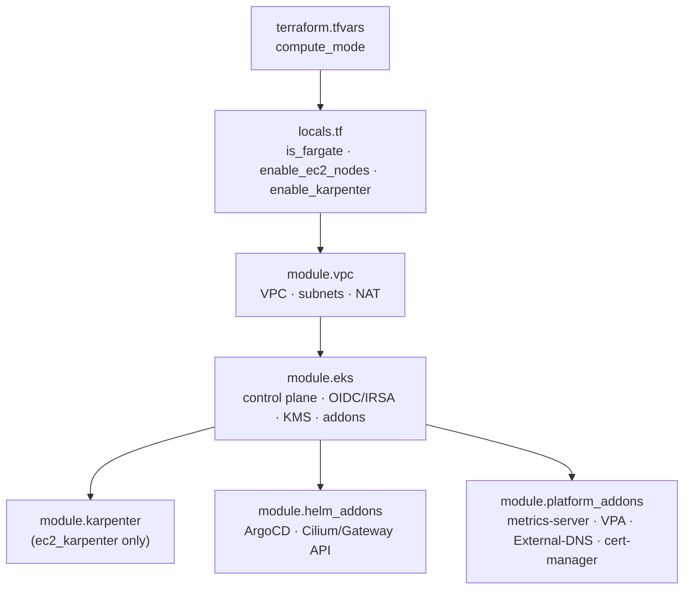
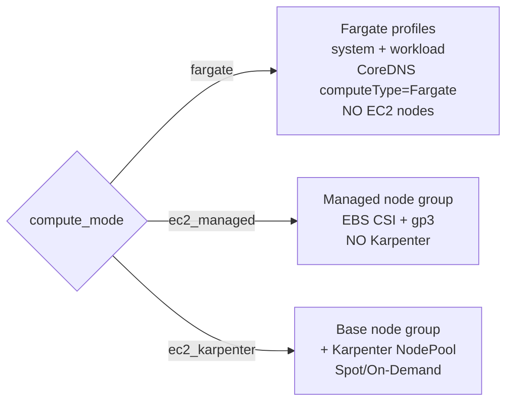

# EKS Platform with Karpenter — Terraform

[](https://github.com/Stivenavila/eks-karpenter-terraform/actions/workflows/ci.yml)
[](LICENSE)


Modular Amazon EKS cluster in Terraform. Switch between **Fargate** (fully serverless)
and **EC2** (managed node group, optionally with Karpenter) by changing **a single
variable**: `compute_mode`.

**Contents:** [Architecture](#0-architecture) ·
[Compute modes](#1-compute-modes-compute_mode) ·
[Switching](#2-how-to-switch) ·
[Networking](#2b-networking-create-a-vpc-or-reuse-one-create_vpc) ·
[Key variables](#3-key-variables) ·
[Blast radius](#4-blast-radius-per-transition) ·
[Rollback](#5-rollback) ·
[Per-mode notes](#6-per-mode-notes) ·
[Local validation](#7-local-validation-no-aws-credentials)

---

## 0. Architecture

**Module topology:**



**Compute decision (inside `module.eks`):**



---

## 1. Compute modes (`compute_mode`)

| Value | Nodes | Autoscaling | Fargate | Typical use |
|---|---|---|---|---|
| `fargate` | None (serverless) | HPA + VPA | kube-system + workloads | Default. Variable workloads, low infrastructure maintenance. |
| `ec2_managed` | Fixed managed node group | HPA + VPA (fixed nodes) | No | Steady workloads, DaemonSets, control over instance types. |
| `ec2_karpenter` | Base node group + Karpenter | Karpenter (nodes) + HPA/VPA | No | Production, dynamic Spot/On-Demand scaling. |

The logic is derived in `locals.tf`:

```hcl
is_fargate       = var.compute_mode == "fargate"
enable_ec2_nodes = contains(["ec2_managed", "ec2_karpenter"], var.compute_mode)
enable_karpenter = var.compute_mode == "ec2_karpenter"
```

---

## 2. How to switch

1. Edit `terraform.tfvars`:
   ```hcl
   compute_mode = "fargate"   # or "ec2_managed" | "ec2_karpenter"
   ```
2. Always dry-run first:
   ```bash
   terraform plan -out=tfplan
   ```
3. Review the plan (see [§4 Blast radius](#4-blast-radius-per-transition)) and apply:
   ```bash
   terraform apply tfplan
   ```
4. Update your kubeconfig and verify:
   ```bash
   aws eks update-kubeconfig --region us-east-1 --name <cluster>
   kubectl get pods -A -o wide      # check where pods run (fargate-* vs ip-*)
   kubectl get nodes                # empty in pure Fargate; nodes in ec2_* modes
   ```

The `Makefile` wraps the same flow: `make plan MODE=ec2_karpenter`, `make apply`,
`make switch-fargate`, `make status`. Run `make help` for the full list.

> The backend is **S3 + DynamoDB locking**. Never edit the state by hand; use
> `terraform state` when needed.

---

## 2.b Networking: create a VPC or reuse one (`create_vpc`)

| `create_vpc` | Behaviour | Required variables |
|---|---|---|
| `true` (default) | `module.vpc` creates the VPC, subnets, NAT, IGW and flow logs. | `vpc_cidr`, `availability_zones` |
| `false` | Creates no network. Reads existing IDs and passes them to EKS. | `existing_vpc_id`, `existing_private_subnet_ids`, `existing_public_subnet_ids` |

`locals.tf` resolves the active source:

```hcl
vpc_id             = var.create_vpc ? one(module.vpc[*].vpc_id) : var.existing_vpc_id
private_subnet_ids = var.create_vpc ? one(module.vpc[*].private_subnet_ids) : var.existing_private_subnet_ids
public_subnet_ids  = var.create_vpc ? one(module.vpc[*].public_subnet_ids)  : var.existing_public_subnet_ids
```

**Requirement when reusing a VPC (`create_vpc = false`):** the subnets must carry the
EKS discovery tags, otherwise the ALB controller and node routing fail:

```bash
# Private
aws ec2 create-tags --resources subnet-aaa subnet-bbb \
  --tags Key=kubernetes.io/role/internal-elb,Value=1 \
         Key=kubernetes.io/cluster/<cluster-name>,Value=shared
# Public
aws ec2 create-tags --resources subnet-ddd subnet-eee \
  --tags Key=kubernetes.io/role/elb,Value=1 \
         Key=kubernetes.io/cluster/<cluster-name>,Value=shared
```

> The `moved {}` block in `main.tf` (`module.vpc` → `module.vpc[0]`) migrates the state
> when `count` is added; a VPC previously created by this code is **not** destroyed.
> Check in the `plan` that the existing VPC shows up as `moved`, not `destroy`.

---

## 3. Key variables

| Variable | Applies to | Description |
|---|---|---|
| `compute_mode` | All | Fargate/EC2 selector. The only variable to change when switching. |
| `fargate_namespaces` | `fargate` | Application namespaces scheduled on Fargate. |
| `fargate_system_namespaces` | `fargate` | System namespaces (default `["kube-system"]`) for CoreDNS and add-ons. |
| `eks_node_instance_types` / `eks_node_*_size` | `ec2_*` | Managed node group sizing. Ignored on Fargate. |
| `karpenter_use_spot` / `karpenter_nodepool_*_limit` | `ec2_karpenter` | Karpenter NodePool settings. |
| `eks_cluster_version` | All | Kubernetes version of the control plane. |

---

## 4. Blast radius per transition

| Transition | What happens | Risk |
|---|---|---|
| `fargate` → `ec2_*` | Creates the EC2 node group, EBS CSI IRSA and (with Karpenter) the NodePool. Removes the Fargate profiles → pods are rescheduled onto EC2. | Brief workload downtime during rescheduling. Drain first if the workload is critical. |
| `ec2_*` → `fargate` | Destroys the EC2 node group, the EBS CSI add-on and Karpenter. Creates Fargate profiles and patches CoreDNS to `computeType=Fargate`. | **EBS-backed PVCs can no longer attach** (Fargate does not support EBS) — migrate to EFS first. DaemonSets (Falco, agents) stop running. |
| `ec2_managed` ↔ `ec2_karpenter` | Adds/removes the Karpenter controller and NodePool. The base node group is untouched. | Low. Karpenter takes about a minute to take over scaling. |

**Built-in protection:** `moved {}` blocks in `modules/eks/main.tf` map the previous
resources (`aws_eks_node_group.main` → `main[0]`, etc.), avoiding destroy/recreate when
`count` is introduced. Check in the `plan` that the existing node group appears as
`moved`, **not** `destroy`.

---

## 5. Rollback

1. `git revert <commit>` (or set `compute_mode` back in `terraform.tfvars`).
2. `terraform plan -out=rollback.plan` and review it.
3. `terraform apply rollback.plan`.

The S3 state is not corrupted: the `moved {}` blocks and `count` are idempotent. If an
apply fails halfway, `terraform apply` is re-entrant (just run it again), or use
`terraform state list` to inspect.

---

## 6. Per-mode notes

**Pure Fargate**
- CoreDNS runs on Fargate through the add-on's `configuration_values = { computeType = "Fargate" }` (native, no `kubectl patch`).
- No DaemonSets: Falco (needs kernel access) and any node-level agent do **not** work. Use sidecar or Fargate-compatible alternatives.
- Persistence: use **EFS CSI** (`aws-efs-csi-driver`), not EBS. The `gp3` StorageClass stays inert.
- Each pod is its own micro-VM; sizing comes from `requests/limits` (tuned by VPA).

**EC2 (`ec2_managed` / `ec2_karpenter`)**
- EBS CSI and the `gp3` StorageClass work for PVCs.
- DaemonSets work (observability, node-level security).
- `ec2_karpenter`: Karpenter provisions nodes on demand; the base node group runs the controller and system pods.

---

## 7. Local validation (no AWS credentials)

```bash
terraform fmt -recursive
terraform init -backend=false
terraform validate
```

Or simply `make fmt validate`. CI runs the same checks plus TFLint and a Checkov
security scan on every pull request.

A real `plan`/`apply` needs an AWS profile with access to the S3 backend configured in
`backend.tf` — change the `bucket` and `profile` there to your own.

## License

[MIT](LICENSE)
